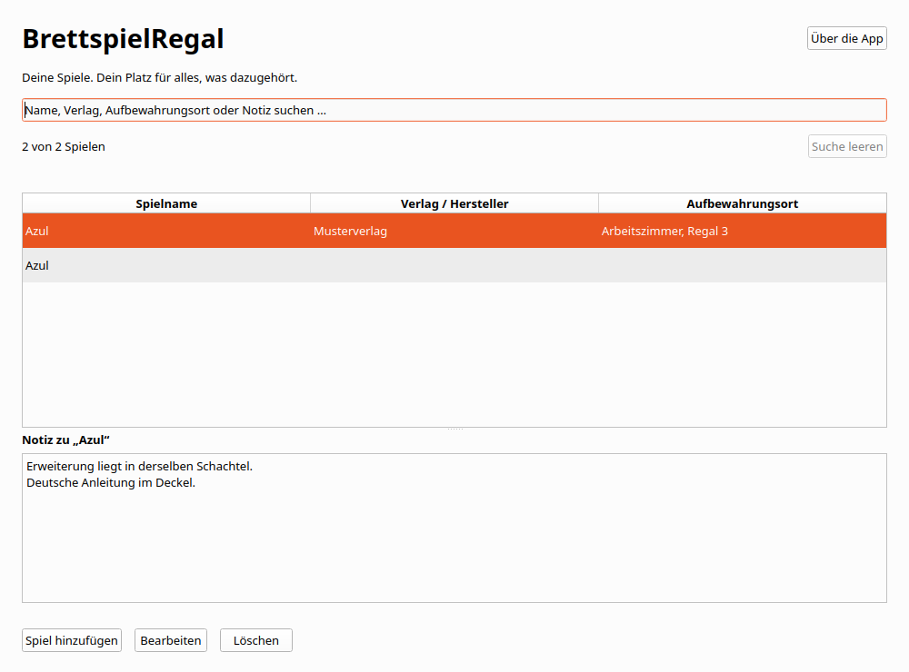

# BrettspielRegal

Eine kleine Desktop-App für deine private Brettspielsammlung. Erfasse den
Spielnamen, Verlag oder Hersteller, Aufbewahrungsort und eine mehrzeilige Notiz.
Suche über alle vier Felder. Die Sammlung bleibt lokal und nach einem Neustart
erhalten. Es gibt kein Konto und die fertige App benötigt kein Internet.



Version 0.1.0 ist die erste C++-Stufe des Hobby-Portfolios und ein kleines,
nachvollziehbares Bewerbungsprojekt. Die späteren Veröffentlichungsziele sind
**zuerst Microsoft Store und danach Mac App Store**. Noch keine Veröffentlichung.

## Entwickeln und starten

Voraussetzungen sind ein C++20-Compiler, CMake ab 3.25, Ninja und Qt 6.8.3 mit
Core, Gui, Widgets, Sql, Test sowie QSQLITE. Die lokal geprüfte Kombination ist
Ubuntu 24.04 x64, GCC 13.3.0, CMake 4.4.4 und Ninja 1.11.1.
clang-format 23.1.3 und clang-tidy 22.1.8 dienen der Prüfung.

Linux und macOS:

```bash
export BRETTSPIELREGAL_QT_ROOT=/absoluter/pfad/zu/Qt/6.8.3/gcc_64
source scripts/env.sh
cmake --preset dev
cmake --build --preset dev --parallel 4
./build/dev/brettspielregal
```

Auf macOS zeigt der SDK-Pfad auf `macos`. Der Launcher liegt im erzeugten
`build/dev/brettspielregal.app/Contents/MacOS/brettspielregal`.
Unter Linux funktioniert alternativ `bash scripts/run.sh`.
Maschinenspezifische SDK- und Werkzeugpfade dürfen in `.tools/env.sh` stehen.
Diese Datei wird nicht versioniert und ist für andere Rechner nicht erforderlich.

Windows, in einer x64-Developer-PowerShell für Visual Studio 2022:

```powershell
$env:BRETTSPIELREGAL_QT_ROOT = 'C:\Qt\6.8.3\msvc2022_64'
$env:CMAKE_PREFIX_PATH = $env:BRETTSPIELREGAL_QT_ROOT
$env:PATH = "$env:BRETTSPIELREGAL_QT_ROOT\bin;$env:PATH"
cmake --preset dev
cmake --build --preset dev --parallel 4
.\build\dev\brettspielregal.exe
```

Für die Entwicklung darf dasselbe installierte Qt-SDK verwendet werden wie für
andere Projekte. App-Code, Daten, Git-Historie und ausgelieferte Laufzeit bleiben
vollständig unabhängig. Neue Abhängigkeiten werden nicht beim App-Start geladen.

## Bedienung

„Spiel hinzufügen“ öffnet den gemeinsamen Eingabedialog. Nur der Spielname ist
erforderlich. Doppelklick oder Enter in der Tabelle öffnet die Bearbeitung.
Gleichnamige Spiele bleiben eigenständige Einträge. Löschen verlangt eine
Bestätigung. Die Notiz des ausgewählten Spiels ist vollständig scrollbar.

| Taste | Aktion |
| --- | --- |
| Strg+N / Cmd+N | Spiel hinzufügen |
| Strg+F / Cmd+F | Suche fokussieren und Text auswählen |
| Strg+S / Cmd+S | Dialog speichern |
| Escape | Dialog abbrechen, bei Änderungen mit Rückfrage |
| Enter im Notizfeld | Neue Zeile |
| Entf in der Tabelle | Löschbestätigung öffnen |
| Cmd+Rücktaste auf macOS | Löschbestätigung öffnen |

„Weiterbearbeiten“ ist bei ungespeicherten Änderungen die sichere Vorauswahl.
Ein Speicherfehler lässt alle Eingaben offen. Während eines Zugriffs sind
Doppelaktionen gesperrt. Nach einem erfolgreichen Speichern außerhalb der
aktuellen Suche erklärt ein Hinweis, warum der Eintrag gerade nicht sichtbar ist.

## Daten und isolierte Tests

Die Datei `brettspielregal.sqlite3` liegt im von Qt ermittelten persönlichen
App-Datenverzeichnis. „Über die App“ zeigt den tatsächlich verwendeten Pfad.
Typische Pfade einer normalen, nicht sandboxierten Installation:

| System | Verzeichnis |
| --- | --- |
| Windows | `%LOCALAPPDATA%\de.appfabrik.brettspielregal` |
| macOS | `~/Library/Application Support/de.appfabrik.brettspielregal` |
| Linux | `$XDG_DATA_HOME/de.appfabrik.brettspielregal`, sonst `~/.local/share/de.appfabrik.brettspielregal` |

Store-Sandbox und Windows-Paketvirtualisierung können die tatsächlichen Pfade
ändern. Die native Abnahme muss diese ermitteln. Es gibt keinen selbst gebauten
Ersatzpfad ins Programmverzeichnis. Zum manuellen Sichern die App schließen und
die SQLite-Datei kopieren. Die zusätzliche `collection.lock` ist keine Nutzerdatenbank.

```bash
./build/dev/brettspielregal --data-dir /tmp/brettspielregal-test
bash scripts/check.sh
ASAN_OPTIONS=detect_leaks=1:halt_on_error=1 UBSAN_OPTIONS=halt_on_error=1 bash scripts/check.sh asan
```

`--data-dir` muss absolut und nicht leer sein. Fehler fallen nicht auf private
Daten zurück. Automatische Tests verwenden `QTemporaryDir` und synthetische
Texte. Eine zweite Instanz derselben Sammlung wird abgewiesen. Externe
gleichzeitige Bearbeitung ist kein unterstützter Arbeitsablauf.

## Aufbau, Pakete und nächste Stufen

Die [Architektur](docs/architecture.md) erklärt C++-Entscheidungen und den
Speicherablauf für ein Bewerbungsgespräch. Der [Prüfbericht](docs/verification.md)
trennt nachgewiesene Prüfungen von offenen Zielsystemtests. Die
[Paketierungsanleitung](docs/packaging.md) beschreibt eigenständige Testpakete
und spätere Store-Schritte. [Lizenzhinweise](THIRD_PARTY_NOTICES.md) gehören dazu.

| Stufe | Eigenständige App | Neue Hauptfunktion |
| --- | --- | --- |
| 1 | BrettspielRegal | Einträge anlegen, bearbeiten, löschen und suchen |
| 2 | SammlerVitrine | Ein Foto pro Eintrag |
| 3 | ModellbauProjekt | Projektstatus |
| 4 | HolzwerkProjekt | Checkliste |
| 5, Reserve | RestaurierungsHeft | PDF-Export |

Jede spätere App übernimmt die vorherigen Grundfunktionen. Hier gibt es keine
Fotos, Statuswerte, Checklisten, PDF-Exporte, Ausleihe, Bewertungen oder
Online-Anbindungen. FactoryForge bleibt ein separates größeres Projekt.
