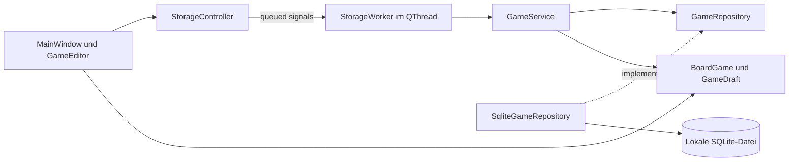

# Architektur und C++-Entscheidungen

Ein CMake-Projekt enthält drei kleine interne Bibliotheken und den Launcher.
Die Targets erzwingen die Grenze zwischen Modell, Speicher und Oberfläche.
Es gibt kein Plugin-System und keinen gemeinsamen Portfolio-Kern.

## Modell und Identität

`GameDraft` enthält vier QString-Werte. `BoardGame` ergänzt eine numerische
64-Bit-ID. SQLite erzeugt sie über `INTEGER PRIMARY KEY AUTOINCREMENT`.
Der Name darf doppelt vorkommen. Weder Listenposition noch Name identifizieren
einen Datensatz. Auch nach Sortieren, Filtern oder Umbenennen bleibt die ID stabil.

`validateDraft` trimmt die einzeiligen Felder mit Unicode-Leerraumerkennung.
Ein leerer Name erzeugt einen eigenen Validierungsfehler. Die Notiz wird nicht
getrimmt. Der Editor behandelt sie als Klartext, nicht als HTML. Zeilenumbrüche
werden vom Qt-Texteditor in seiner üblichen LF-Darstellung verarbeitet.

Die Suche läuft für die bewusst kleine Sammlung im Speicher. NFC-Normalisierung,
Unicode-Case-Folding und erneute NFC-Normalisierung behandeln zusammengesetzte
und zerlegte Umlaute gleich. Jedes Feld wird separat geprüft. Ein deutscher
QCollator sortiert Namen mit natürlicher Zahlenreihenfolge. Bei gleicher
Sortierposition entscheidet die ID. Eine größere Datenmenge würde eine andere
Suchstrategie rechtfertigen, ist aber nicht Gegenstand dieser App.

## Ein vollständiger Speichervorgang

1. Der gemeinsame Dialog hält den ursprünglichen und den aktuellen Textstand.
   Ein Feldvergleich schützt auch ausschließlich geänderte Notizen.
2. Validierung meldet Fehler im Dialog. Texte bleiben zur Korrektur erhalten.
3. Der Controller sperrt weitere Datenbankaktionen. Ein queued Signal übergibt
   eine Wertkopie des Entwurfs an den Worker.
4. Der Service validiert erneut und entscheidet anhand der ID zwischen
   Anlegen und Bearbeiten. Der Repository-Vertrag kennt keine Widgets oder SQL.
5. Das Repository bindet Werte an vorbereitete QSqlQuery-Anweisungen. Nutzereingaben
   werden nicht in SQL interpoliert. Ein Transaction-Objekt führt bei jedem
   vorzeitigen Ausgang ein Rollback aus.
6. Erst nach erfolgreichem Commit wird der gespeicherte Wert zurückgemeldet.
   Die GUI aktualisiert ihren Stand und schließt den Dialog. Ein Fehler erhält
   den vollständigen Entwurf und lässt einen erneuten Versuch zu.

Nach einem Commit wird die GUI-Liste direkt mit dem bestätigten Datensatz
aktualisiert. Es gibt keine nachgeschaltete Leseoperation, deren Fehler ein
bereits erfolgreiches Speichern fälschlich als fehlgeschlagen darstellen könnte.

## RAII, Ownership und Signale

Widgets gehören über Qt-Parent-Ownership zu ihrem Fenster. Der Controller
besitzt den QThread als Member. Der Worker lebt in diesem Thread und besitzt
das Repository über `std::unique_ptr`. Es wird erst im Worker erzeugt.
Das Repository besitzt seine benannte Qt-SQL-Verbindung und das QLockFile.

QSqlQuery lebt jeweils lokal. Beim Repository-Abbau werden erst Verbindung und
Handles freigegeben, dann wird die Verbindung aus Qt entfernt. Kein fremder
Thread benutzt sie. Die Datenbank-Wartefrist ist auf zwei Sekunden begrenzt.
Der GUI-Thread führt weder SQL noch diese Wartezeit aus.

Signalverbindungen mit Empfänger-Kontext werden bei dessen Zerstörung getrennt.
Das Hauptfenster hält seinen Editor als QPointer. Späte Ergebnisse können so
keinen zerstörten Dialog erreichen. Im normalen Ablauf verhindert das Fenster
das Beenden während einer laufenden Operation. Der Controller beendet danach
den Thread geordnet. Sein Destruktor wartet auch beim außergewöhnlichen Abbau
auf einen sicheren Abschluss. Der Worker wird im eigenen Thread freigegeben.

Konstante Referenzen für gelesene Werte, Wertkopien an Threadgrenzen und klar
benannte besitzende gegenüber nicht besitzenden Referenzen machen die
Lebenszyklen im Bewerbungsgespräch nachvollziehbar.

## Schema und Fehler

Schema 1 besteht aus einer Tabelle mit ID und vier nicht-nullbaren Textfeldern.
Die Versionsnummer liegt in `PRAGMA user_version`. Nur nicht vorhandene
Datenbanken werden neu angelegt. Vorhandene leere Dateien, unbekannte Schemata,
neuere Versionen und beschädigte Dateien werden nicht überschrieben.
Eine Integritätsprüfung und die erwarteten Spalten sichern den Start ab.

Die App lässt nur eine Instanz pro kanonischem Datenverzeichnis zu. Ein externes
SQLite-Werkzeug kann weiterhin Sperren verursachen. Diese führen nach kurzer
Wartezeit zu einer verständlichen Meldung. Ein Fehler wird nie durch eine leere
Sammlung ersetzt. „Neu laden“ erlaubt einen erneuten Öffnungsversuch.

## Prüfbare Grenzen

Domain-Tests prüfen Regeln ohne Widgets. Repository-Tests verwenden echte
SQLite-Dateien in QTemporaryDir. Eine zweite SQLite-Verbindung erzeugt reale
Sperren, auch einen Commit-Fehler nach einer zunächst erfolgreichen Änderung.
Die Tests kontrollieren den gespeicherten Originalstand nach dem Rollback.

GUI-Tests bedienen echte Qt-Dialoge. Ein Repository-Decorator kann einen Zugriff
gezielt verzögern oder fehlschlagen lassen, während SQLite weiterhin den
Normalbetrieb ausführt. Dadurch sind Fehler, Doppelaktionen, Thread-Zuordnung
und zerstörte Empfänger reproduzierbar prüfbar. Rendernde X11-Prüfungen und
Paketstarts ergänzen diese automatisierten Tests.
